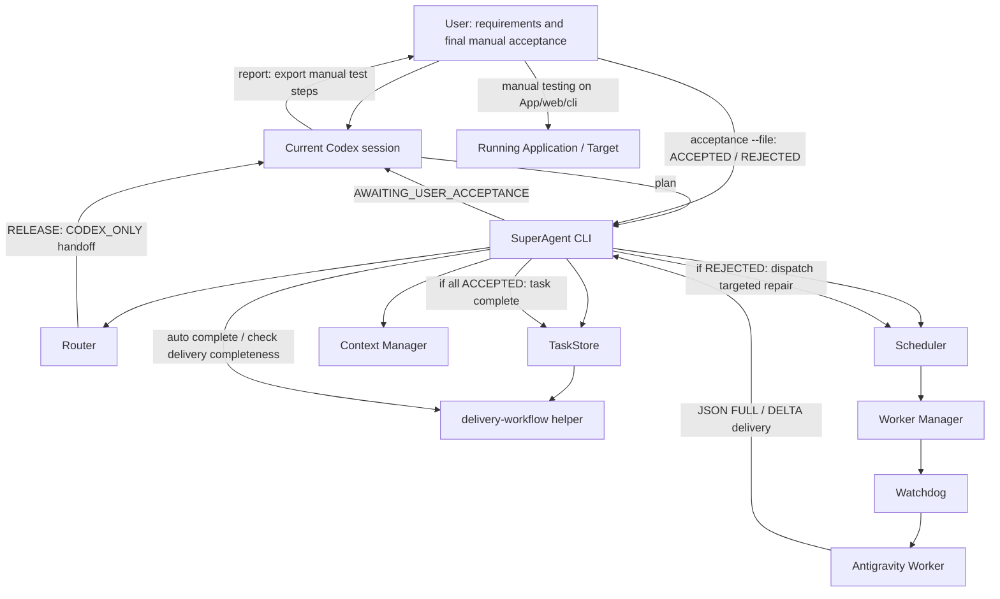

# Architecture

SuperAgent 0.7.0 is a local, single-Worker orchestrator implementing protocol 4.0 (Default Delivery Workflow Policy v1.0). The CLI manages task records, state persistence, and Antigravity Worker dispatches. The **current Codex session** plans requirements and performs completeness-only checks on the Worker's delivery checklist; the **user** performs final manual acceptance. [Release and permission policy](../release-and-permissions.md) adds a separate Codex-only publication branch: GitHub/Gitee publication and version-release work never dispatch to Antigravity.

| Module | Responsibility |
| --- | --- |
| Router | Normalize the WorkOrder, requirement IDs, observable `acceptanceCriteria`, `dependsOn` graph, review mode, and limits. |
| Scheduler | Enforce task transitions (including `AWAITING_USER_ACCEPTANCE`, `ACCEPTED`, `BLOCKED`, `CHANGES_REQUESTED`) and retry limits. |
| Worker Manager | Invoke the Worker with argument arrays, maintain session continuity, and extract structured FULL / DELTA delivery reports. |
| Context Manager | Prepare task context, independent worktree checks, scope boundaries, and targeted incremental feedback. |
| Watchdog | Bound process output and manage timeouts, cancellations, and process-group exit checks. |
| TaskStore | Persist schema 5-compatible task records, delivery/acceptance history, and task locks. |
| `task-store/delivery-workflow.mjs` | Pure helper module: validates FULL/DELTA reports, merges revisions, evaluates no-progress limits, applies user acceptance decisions, and generates reports. |

`plan` registers a WorkOrder with `taskKind` and `agyPermissionPolicy`. Release tasks return `CODEX_ONLY` to the current Codex session before Worker dispatch; mixed requests must be split. This is a handoff, not an automatic model launch or release. Routine tasks default to session-scoped `AUTO_APPROVE` with terminal isolation; `STANDARD` retains normal approvals. Platform/admin denials, scope, and credentials protection remain enforced. `auto` dispatches routine coding and continues original Worker sessions to complete missing fields or unfinished items (`TODO`, `PARTIAL`, `REJECTED`) within the shared retry limit. The Worker may perform as-needed local self-checks (e.g. build, lint, unit tests). Once all runnable items reach `READY_FOR_ACCEPTANCE`, the task enters `AWAITING_USER_ACCEPTANCE`. Codex checks delivery completeness and exports the report; the user performs manual testing and submits decisions via `acceptance`.

Independent requirements continue when another item is `BLOCKED`. A no-progress stopping policy stops retrying an item after two consecutive attempts without substantive progress. Legacy schema 4 records, `CODEX_FUNCTIONAL_CHECK`, and `CODEX_STARTUP_CHECK` remain readable with their original meanings; legacy passes are never converted into user acceptance.

For the detailed contract, see [delivery-protocol.md](delivery-protocol.md). For the legacy protocol, see [functional-protocol.md](functional-protocol.md).
